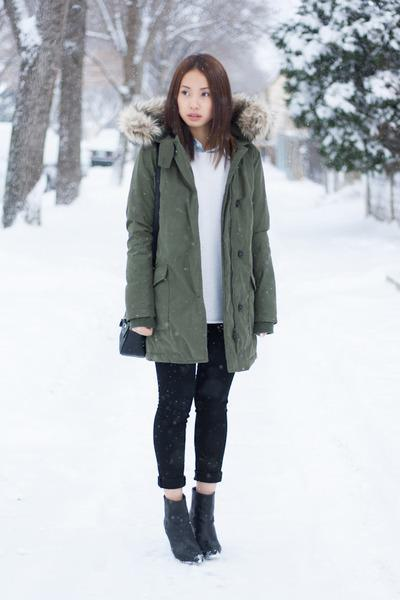
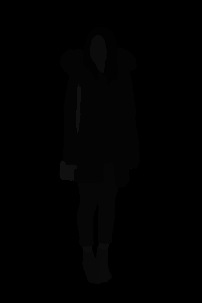
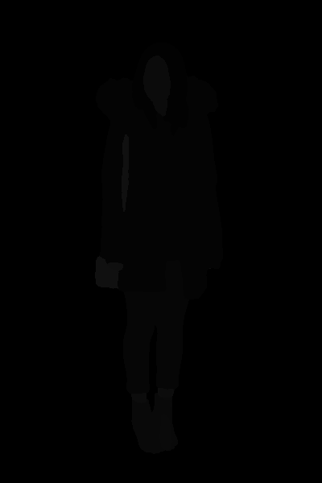
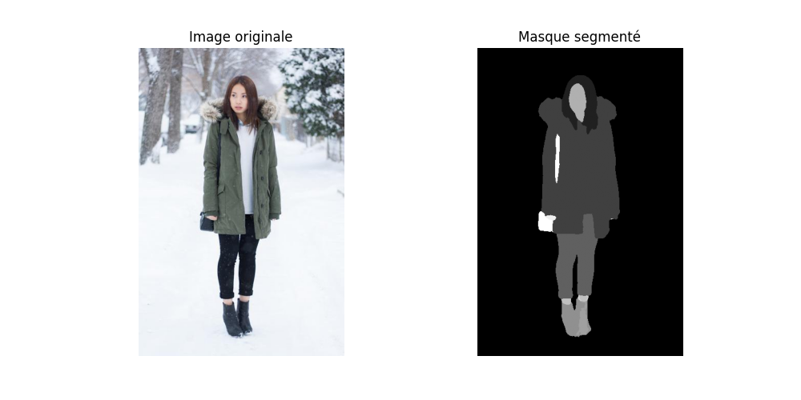

# Segmentation de vêtements

Ce projet segmente des images avec le modèle Hugging Face et compare les masques prédits aux masques de référence avec l'IoU.

## Installation

Depuis la racine du projet, dans PowerShell :

```powershell
py -m venv .venv
.\.venv\Scripts\Activate.ps1
pip install -r requirements.txt
```

Créez un fichier `.env` à partir de `.env.example`, puis renseignez votre token Hugging Face :

```dotenv
token=votre_token_huggingface
api_local=false
only_test=false
```

## Traiter une image

Placez l'image `image_0.png` dans `assets\IMG` et configurez `max_images = 1` dans `main.py`. Lancez ensuite :

```powershell
python main.py
```

Le script traite la première image trouvée dans `assets\IMG`. Pour être certain de traiter `image_0.png`, vérifiez que c'est bien cette image qui est sélectionnée.

Pour cet exemple, les fichiers attendus sont :

- Image d'entrée : `assets\IMG\image_0.png`
- Masque généré : `assets\Mask\mask_image_0.png`
- Comparaison visuelle : `resultats_segmentation\image_0_comparison.png`
- Masque de référence : `assets\Reference\mask_image_0.png`

Le traitement lance également la comparaison IoU des masques des dossiers `assets\Mask` et `assets\Reference`.

### Images de l'exemple

Image d'entrée :



Masque généré et masque de référence :

| Masque prédit | Masque de référence |
| --- | --- |
|  |  |

Résultat de comparaison enregistré par le script :



## Comparer les masques directement

Pour afficher l'IoU de cette paire uniquement :

```powershell
python iou.py assets\Mask\mask_image_0.png assets\Reference\mask_image_0.png
```

Les deux masques doivent avoir les mêmes dimensions et contenir les identifiants de classe de segmentation.

## Exemple de traitement de 3 images

py .\main.py                                     
Dossier 'assets/IMG' existant.
Mode : local -> http://localhost:8000/segment
3 image(s) à traiter : ['assets/IMG\\image_0.png', 'assets/IMG\\image_1.png', 'assets/IMG\\image_2.png']
Valeur de only_test : False

Mode test uniquement désactivé.
Toutes les étapes de traitement seront effectuées.

Traitement de 3 image(s) en batch...
Traitement de l'image : assets/IMG\image_0.png
Code de statut de la réponse : 200
Masque généré avec succès.
Masque sauvegardé sous 'assets/Mask/mask_image_0.png'.
Temps de traitement de assets/IMG\image_0.png : 10.48 secondes.
Coût estimé pour assets/IMG\image_0.png : 0.001257 $.
Traitement de l'image : assets/IMG\image_1.png
Code de statut de la réponse : 200
Masque généré avec succès.
Masque sauvegardé sous 'assets/Mask/mask_image_1.png'.
Temps de traitement de assets/IMG\image_1.png : 10.51 secondes.
Coût estimé pour assets/IMG\image_1.png : 0.001262 $.
Traitement de l'image : assets/IMG\image_2.png
Code de statut de la réponse : 200
Masque généré avec succès.
Masque sauvegardé sous 'assets/Mask/mask_image_2.png'.
Temps de traitement de assets/IMG\image_2.png : 9.78 secondes.
Coût estimé pour assets/IMG\image_2.png : 0.001173 $.
Coût estimé pour 500 000 images (moyenne des segmentations réussies) : 615.35 $.
Traitement en batch terminé.
Affichage des résultats du batch...
Comparaison sauvegardée dans resultats_segmentation/image_0_comparison.png
Comparaison sauvegardée dans resultats_segmentation/image_1_comparison.png
Comparaison sauvegardée dans resultats_segmentation/image_2_comparison.png
Lecture des paires image/mask effectuée.
Résultat pour la paire 0 :
Résultat sauvegardé dans resultats_segmentation\result_0.png
Résultat pour la paire 1 :
Résultat sauvegardé dans resultats_segmentation\result_1.png
Résultat pour la paire 2 :
Résultat sauvegardé dans resultats_segmentation\result_2.png
Tous les résultats ont été sauvegardés.
Temps total d'exécution : 32.78 secondes.
Coût total estimé : 0.003933 $.

Évaluation IoU des masques prédits par rapport aux références...
mask_image_0.png : IoU moyenne hors fond = 86.9%
mask_image_1.png : IoU moyenne hors fond = 84.5%
mask_image_2.png : IoU moyenne hors fond = 93.6%

Bilan IoU : 3 paire(s) comparée(s).
IoU moyenne globale hors fond : 87.9%
  Classe 1 (Hat) : IoU moyenne = 98.4%
  Classe 2 (Hair) : IoU moyenne = 97.8%
  Classe 4 (Upper-clothes) : IoU moyenne = 96.8%
  Classe 5 (Skirt) : IoU moyenne = 72.6%
  Classe 6 (Pants) : IoU moyenne = 97.6%
  Classe 7 (Dress) : IoU moyenne = 76.8%
  Classe 9 (Left-shoe) : IoU moyenne = 87.7%
  Classe 10 (Right-shoe) : IoU moyenne = 78.9%
  Classe 11 (Face) : IoU moyenne = 98.0%
  Classe 12 (Left-leg) : IoU moyenne = 86.1%
  Classe 13 (Right-leg) : IoU moyenne = 54.3%
  Classe 14 (Left-arm) : IoU moyenne = 82.3%
  Classe 15 (Right-arm) : IoU moyenne = 91.1%
  Classe 16 (Bag) : IoU moyenne = 76.8%